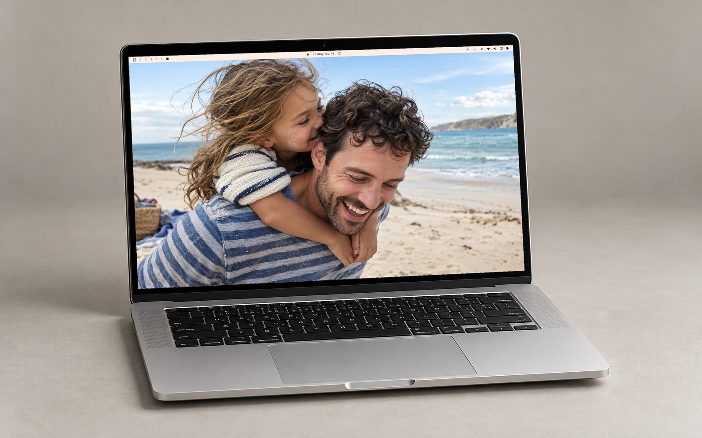

# Photo Wallpapers for Omarchy

Your photos, a quieter desktop. Choose iCloud photos in a native Omarchy panel,
rotate them on a schedule, and optionally match your system's light/dark colours
to the photo. The backend is Rust; the interface is native Quickshell/QML.



The promotional family photographs are AI-generated and feature fictional
people. Their wallpaper rendering and themed screen content come from the real
application. MacBook device scenes are illustrative composites. See
[promotional provenance](assets/promo/PROVENANCE.md).

[View the eight light/dark style examples and native panel](docs/GALLERY.md).
Original desktop screenshots accompany every illustrative device frame.

## Features

- Direct Apple sign-in, normal verification/device approval and on-demand photo downloads.
- Mixed cloud sources; optional Mac metadata adds verified named People and local albums.
- One-hour default, custom intervals, Next/Previous, Pause, Pin and persistent exclusions.
- Cached image preparation, subject-preserving fallback and offline rotation.
- Optional photo-derived themes: Neutral, Subtle, Tinted and Rich; Light/Dark/Auto.
- Local sunrise/sunset, current-area or fixed-location settings, and soft day/night photo preferences.
- Optional local Meeting Mode with automatic screening, durable protection and per-photo corrections.

A Mac, Tailscale and Python are unnecessary for ordinary Omarchy use. The
optional read-only Mac helper enriches metadata; image downloads still come
from Apple. Theme matching is off until enabled. No remote image-analysis API,
paid service, GPU or generative image service is used by the installed app.
The sample wallpapers were generated separately for demonstration.

## Installation

Supported release target: **x86_64 Arch Linux with Omarchy Quattro**, tested
against Omarchy 4.0.5-1 and its installed Quickshell APIs. The distribution's
version file may still say 4.0.0.alpha. Other distributions, architectures and
replacement bars are not verified. This is a native plugin plus a separate
user backend; adding the plugin does not install/build the backend.

1. Review this repository, then add the plugin:

   ```sh
   omarchy plugin add https://github.com/domderen/omarchy-photo-wallpapers-plugin.git --enable
   ```

2. Install the backend using either the verified release archive or source:

   **Release archive:** obtain the versioned `arch-x86_64.tar.gz` and
   `SHA256SUMS` from this repository's Releases page. In a dedicated download
   directory run `sha256sum -c SHA256SUMS`, extract the archive, read
   `INSTALL.txt` and `BUILD.json`, then run the contained executable:

   ```sh
   ./omarchy-photo-wallpapers install --backend-only
   ```

   It requires the system `libheif >=1.23.7`, glibc and normal Omarchy desktop
   commands. Check BUILD.json for the actual build environment and shared
   library requirements. The archive is for current Arch, not a universal
   portable Linux binary. Install libheif through Arch's signed packages.

   **Build from source:** install Arch `rust`, `pkgconf` and `libheif`, then
   run this from the Git-managed plugin checkout:

   ```sh
   scripts/install-omarchy --backend-only
   ```

   Build requirements are Rust 1.99+ and libheif 1.23.7+. No Python/Node runtime
   is required on Linux.

3. Open the bar widget. Enter your Apple Account/password in its native fields
   and complete Apple's verification normally. Select sources, set the interval
   and Save. No source is selected automatically; a fresh interval is 3600 seconds.

Optional theme matching uses separately installed **Matugen 4.x**. Install the
Arch `matugen` package, then enable matching in System Theme. Choose style,
Light/Dark/Auto and location. See [usage and limitations](docs/USAGE.md).

Optional [Meeting Mode](docs/MEETING_MODE.md) downloads pinned native CPU models
and ONNX Runtime separately (about 293 MB; allow additional staging space).
It requires x86_64 Linux, working system `bsdtar` or `tar`, and no Python.
Start it before screen sharing and wait for Active. Screening can miss details
and excludes many ordinary photos; read its [measured limits](docs/PRIVACY_MODEL_EVALUATION.md).
Both privacy settings default off.

Keep Arch and its image-codec packages updated. HEIF parsing refuses a loaded
libheif older than 1.23.7, including after a system downgrade; that floor covers
the upstream fixes reviewed for this release and does not guarantee future safety.

## Updates and removal

End Meeting Mode and turn off the Personal filter before updating or removing
the plugin or backend. Review and run `omarchy plugin update domderen.photo-wallpapers`, then install
the corresponding backend archive or repeat the source-build command above.
The backend installer preserves the Git checkout and waits for a compatible local daemon before reporting success; failed activation restores the previous owned installation. Protocol-incompatible
backends cannot receive widget actions; update the pair together. Releases
advertise IPC version 1; pre-0.4 backends need upgrading. Patch releases may
share the protocol. Version 0.5 uses storage schema 3; an older backend must
never open that database. Use the actual source commit when reviewing changes:
marketplace verification may cover a different commit from current upstream.

Backend updates retain rollback copies under private application data. For a
rollback, restore the matching previously reviewed backend and plugin commit;
stop the service and retain a consistent private database backup before any
schema downgrade. Never run two daemons against one profile.

Disabling/removing the plugin also removes its protective desktop surface; end
protection explicitly first. The separate backend can
continue rotating. Stop it with `systemctl --user stop omarchy-photo-wallpapers`.
Remove the backend with `omarchy-photo-wallpapers uninstall`, then remove the
checkout with `omarchy plugin remove domderen.photo-wallpapers`. Settings,
sessions, history and media remain by default. `uninstall --purge` explicitly
deletes this app's private state. Uninstall restores a matching theme only
while the app still owns it, preserving a manual theme choice.

Read [security reporting](SECURITY.md), [license and notices](NOTICE.md),
[optional Mac setup](docs/MAC_SETUP.md) and [development](docs/DEVELOPMENT.md).
This independent project is not affiliated with Apple or Omarchy.
