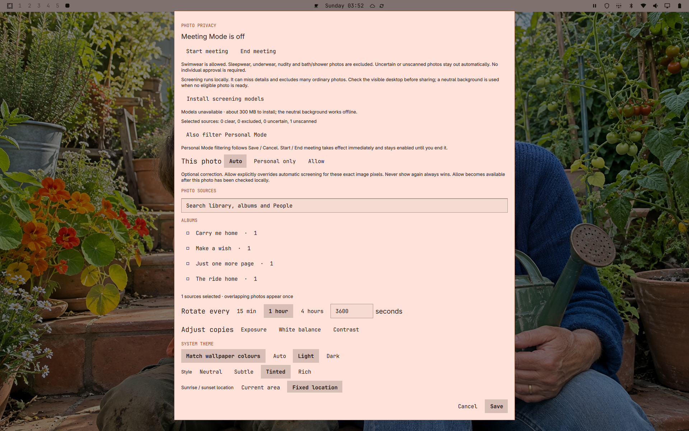

# Meeting Mode

Meeting Mode screens photos from your existing selected sources locally. Cleared photos can be used automatically; individual approval is optional. Start it before sharing a screen and wait for **Active**.

## Native controls

1. Open **Photo Wallpapers → Photo privacy** and choose **Install screening models**. This optional download is about 300 MB on x86_64 Linux.
2. Choose **Start meeting**, or click the shield beside the Photo Wallpapers bar icon. Entry immediately protects an unsafe current wallpaper, including when it was paused or pinned.
3. Wait for **Active**. A neutral background is available offline while eligible photos are prepared. Active confirms the protective desktop surface, rather than promising that a model cannot make a mistake.
4. Choose **End meeting** when finished. Meeting Mode stays enabled across restarts until explicitly ended. Your personal sources, interval, pin and pause are preserved.

**Also filter Personal Mode** follows the panel's normal Save/Cancel flow. Start/End meeting, model installation and per-photo corrections take effect immediately. An older settings draft conflicts instead of overwriting a newly enabled mode.

The installer adds **Super+Ctrl+M** for On and **Super+Ctrl+Shift+M** for Off when both are free. It preserves unrelated Lua bindings and reports a conflict instead of replacing another shortcut. Its own unchanged block is removed during supported uninstall.

The signed-out fictional demonstration below shows the actual optional setup
controls; its models are not installed. [All eight themes](GALLERY.md) have
current native control captures.



## Policy and corrections

Swimwear is allowed when all other checks clear. Sleepwear/pajamas, underwear, nudity and bathing/shower scenes are excluded. Uncertain, unscanned and failed results do not automatically pass. A swimwear result cannot cancel another blocked signal in the same photo. Ordinary clothed sleeping is not itself a blocked category, although the current models often exclude it through uncertainty.

The current photo offers optional **Auto**, **Personal only**, and **Allow** controls. Personal only persists for that account/library asset. Allow is deliberate user control for exact, verified image content; an edit does not inherit it. Allow becomes available after a local full-image check exists. Never show again always wins. No review inbox or individual approval is required to fill the screened queue.

Source selection, crop framing and day/night preferences continue inside the eligible pool. The pool may be smaller than the ordinary library. Pausing holds safe content; Next can request another eligible image. If models, the account, network or usable evidence are unavailable, the neutral background or already eligible cached content remains usable. The panel withholds unconfirmed previews and returns to neutral when the daemon disconnects.

## Quality and resources

The selected policy is conservative. Its fixed 72-image public reference admitted 3/30 ordinary and 2/19 swimwear examples, with 0/6 sleepwear, 0/13 underwear and 0/4 bathing examples admitted. False exclusions are substantial. Small/occluded subjects and personal-library accuracy remain unmeasured; screening can miss details. See [the evaluation and exact limits](PRIVACY_MODEL_EVALUATION.md).

On the authorized Intel host, a complete cold screening job had p95 8.52 seconds and peak process RSS about 450 MiB under a 40% CPU cap. Work is incremental with backoff. Models run in a short-lived, single-threaded native subprocess, outside QML; an admitted cached change performs no inference, recropping or repeated palette generation. No automatic screening runs while both protection settings are off. Photos are never uploaded to a screening service.

Model/data/native-runtime installation is optional and hash verified. No Python runtime is installed on Omarchy. Model weights, full-frame evidence, image-associated decisions and corrections remain in private application data, principally `~/.local/share/omarchy-photo-wallpapers/privacy/`. Prepared media remains in the existing private caches. Originals and Apple Photos person assignments are untouched.

## CLI and lifecycle

```sh
omarchy-photo-wallpapers models install
omarchy-photo-wallpapers models status
omarchy-photo-wallpapers models cancel
omarchy-photo-wallpapers meeting on
omarchy-photo-wallpapers meeting status
omarchy-photo-wallpapers meeting off
```

On/Off are idempotent. A failed entry offers Retry protection without requiring an unsafe intermediate exit. With no native display confirmation, the service keeps an arming/error state instead of claiming readiness. Do not start sharing until the actual desktop and state are suitable.

Plugin updates/removal and supported backend uninstall require ending Meeting Mode and disabling the Personal filter first. A supported active upgrade requires an already confirmed protected surface and matching privacy-capable code. Do not restore a backend/plugin older than 0.5 while protection is enabled; after explicitly ending protection, restore the matching pre-upgrade code/database backup. Older runtimes must not be pointed at the version-3 store. Lifecycle and mode mutations are serialized so entry cannot race supported removal. Uninstall preserves private application data unless purge is explicitly requested.

A small source pool that exhausted its missing-model retries can retain the existing five-minute retry delay after installation. Protection stays neutral while it waits. Installing models before entry avoids this case.
